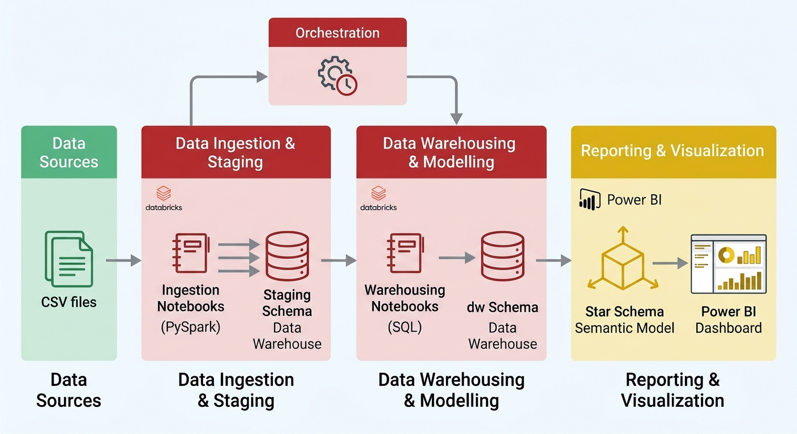
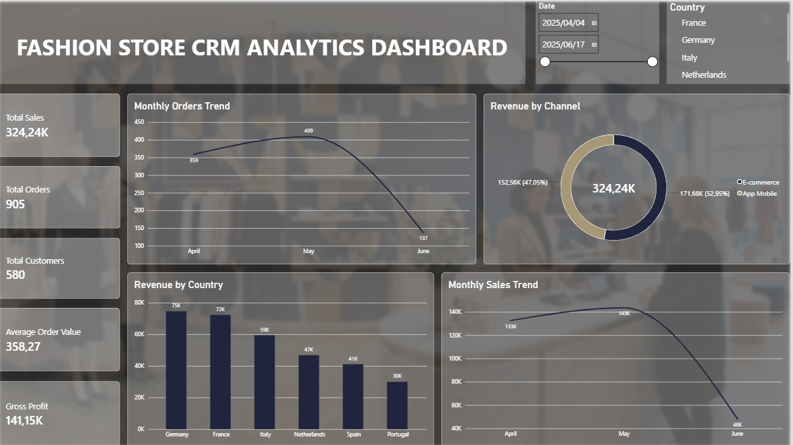
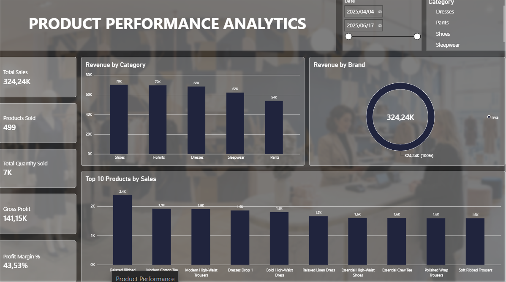
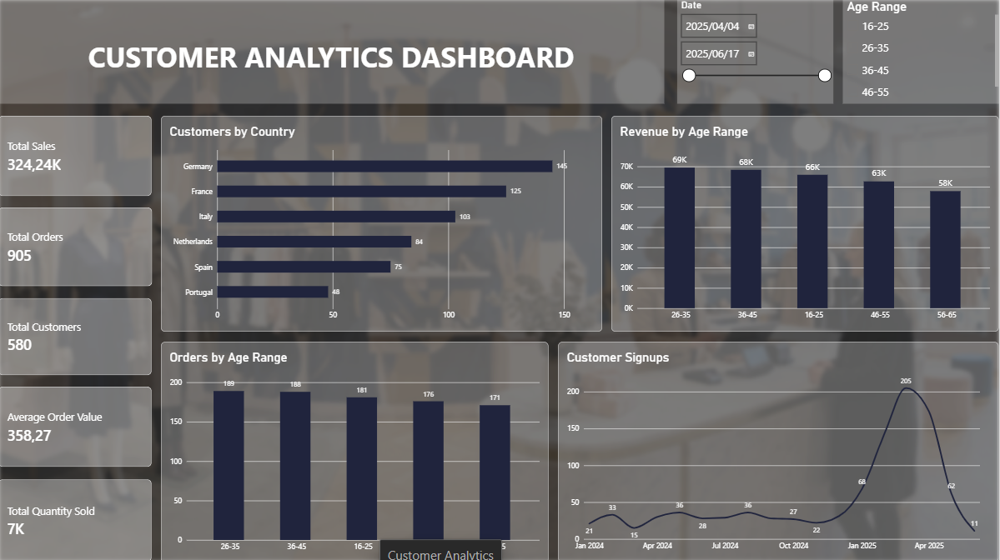
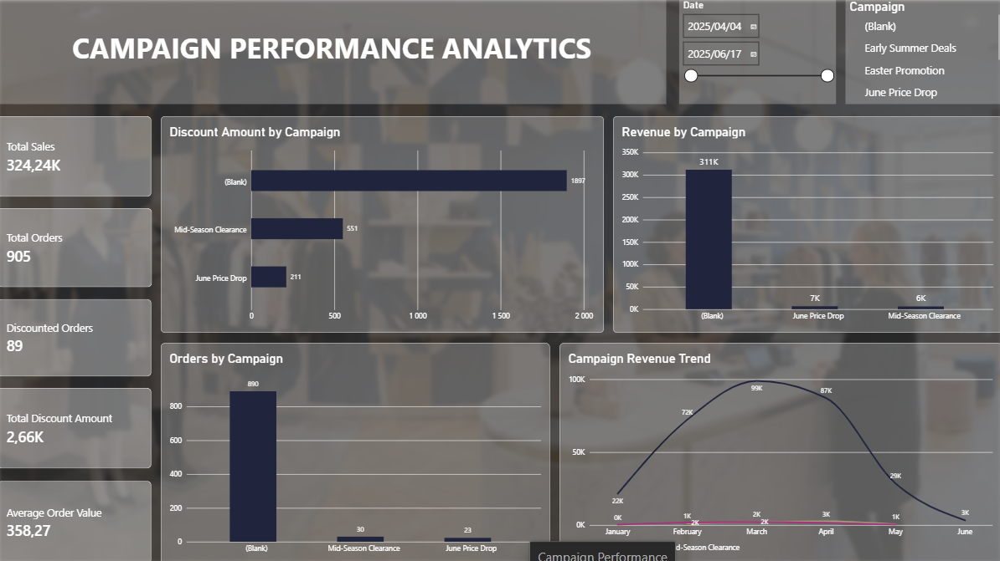
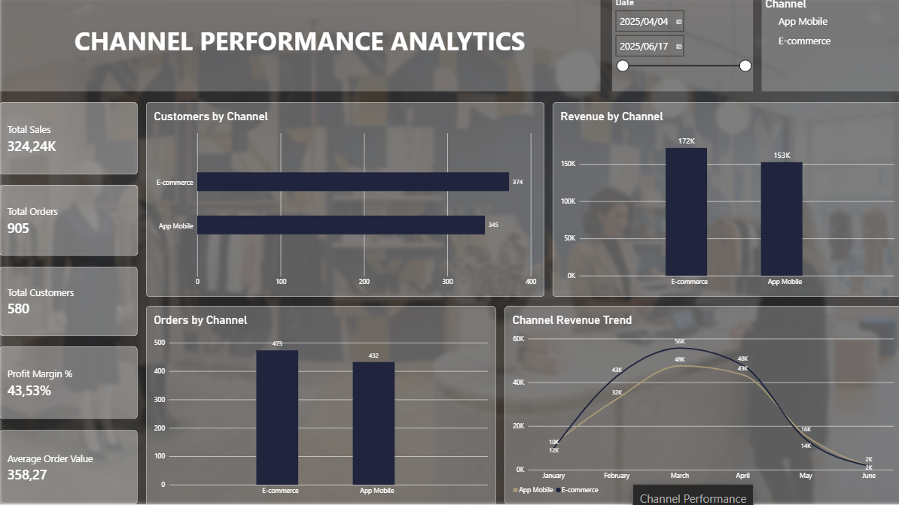

# Fashion Store CRM Analytics

## Project Overview
An end-to-end retail data and business intelligence solution built with Databricks and Power BI for a European fashion retail business operating across E-commerce and Mobile App channels. It takes raw retail transaction records, organizes them into a structured reporting foundation, models key business metrics, and delivers interactive visual dashboards.

## Problem Statement
Fashion retailers generate high volumes of data across multiple digital channels, making it difficult to get a clear, unified view of business performance from raw records alone. Without a centralized analytics solution, tracking sales trends, understanding customer purchasing habits, evaluating promotional campaigns, and comparing channel performance takes manual effort and slows down decision-making.

## Objectives
* Centralize multi-channel retail data into a single, reliable reporting foundation.
* Automate data ingestion and preparation to reduce manual work and improve consistency.
* Establish standardized business metrics across sales, customers, products, and promotions.
* Deliver clear, interactive dashboards to support strategic and operational decisions across retail teams.

## Solution Overview
The solution moves retail data step by step from raw source files through automated cloud data processing and warehousing into a unified business metric model. From there, it powers five interactive Power BI dashboards that give stakeholders a single source of truth across key retail functions.

## Executive Overview
Gives leadership a high-level view of overall revenue, profitability, order volume, customer activity, and sales trends in one place to guide strategic planning.

## Product Performance
Highlights how individual products, categories, and brands contribute to overall revenue, helping teams identify best-sellers and shape merchandising and inventory decisions.

## Customer Analytics
Provides insights into customer demographics and buying habits, helping stakeholders identify high-value customer segments and understand how different groups drive sales.

## Campaign Performance
Evaluates the impact of promotional campaigns and discount initiatives on sales volume and customer engagement to support smarter marketing decisions.

## Channel Performance
Compares customer engagement, order activity, and revenue contribution between E-commerce and Mobile App platforms to show how each sales channel performs.

## Tasks & Activities
* **Data Ingestion:** Built automated workflows to bring raw retail files into the cloud platform, validate quality, and standardize records.
* **Data Warehousing:** Designed a structured reporting warehouse to organize historical sales, product, customer, and campaign data for fast analysis.
* **Workflow Orchestration:** Configured automated, scheduled pipelines so data updates run reliably from end to end.
* **Semantic Modeling:** Created a centralized business metric layer covering sales, profitability, orders, customers, and discounts so reports share consistent numbers.
* **Interactive Dashboards:** Built five visual Power BI dashboards tailored for executive, merchandising, marketing, and channel teams.

## Technology Stack
* **Data Platform & Processing:** Databricks, PySpark, SQL
* **Storage & Warehousing:** Delta Lake
* **Orchestration:** Databricks Jobs
* **Business Intelligence & Reporting:** Microsoft Power BI (Semantic Model, DAX, Interactive Dashboards)
* **Version Control:** GitHub
