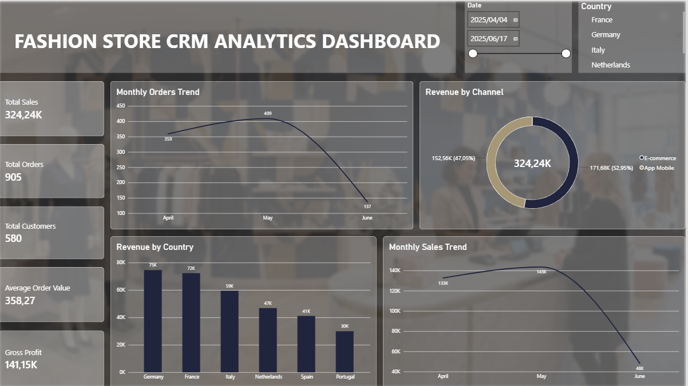

# Fashion Store CRM Analytics

## Project Overview

Fashion Store CRM Analytics is an end-to-end analytics solution developed using Databricks and Power BI.

The project is based on a simulated European fashion retail business operating through E-commerce and Mobile App channels. Although the dataset is fictional, it has been designed to reflect realistic retail operations, customer behaviour, sales transactions, promotional campaigns, and business reporting requirements.

The solution transforms raw retail data into actionable business insights through data ingestion, warehousing, orchestration, semantic modelling, and interactive dashboard reporting.

---

## Problem Statement

Modern fashion retailers generate large volumes of transactional data across multiple sales channels. While the data contains valuable information, raw datasets alone do not provide meaningful business insights for decision-making.

Business stakeholders need a centralized analytics solution that enables them to monitor performance, understand customer behaviour, evaluate campaign effectiveness, analyse product sales, and compare channel performance.

Without a structured analytics platform, identifying trends, opportunities, and areas for improvement becomes challenging and time-consuming.

---

## Objectives

- Build an end-to-end analytics solution using Databricks and Power BI.
- Design and implement a dimensional data warehouse using a Star Schema.
- Automate data ingestion and transformation processes.
- Develop a semantic model for self-service analytics.
- Create interactive dashboards to support business decision-making.
- Deliver actionable insights across customers, products, campaigns, sales, and channels.

---

## KPI Metrics

### Sales Metrics

- Total Sales
- Total Orders
- Average Order Value
- Gross Profit
- Profit Margin %

### Customer Metrics

- Total Customers

### Product Metrics

- Total Quantity Sold
- Products Sold

### Campaign Metrics

- Total Discount Amount
- Discounted Orders

---

## Solution: Fashion Store CRM Analytics

Fashion Store CRM Analytics follows a modern analytics architecture that ingests raw CSV files into Databricks, processes and stores data within a dimensional data warehouse, automates transformations through Databricks Jobs, and delivers business insights through Power BI dashboards.

The solution provides stakeholders with a single source of truth for analysing business performance and enables data-driven decision-making across key retail functions.

---

## Architecture Diagram

### Solution Architecture

> Replace the placeholder below with the architecture diagram screenshot.

```text
[Insert Architecture Diagram Here]
```

---

## Sheet 1: Executive Overview

The Executive Overview dashboard provides a high-level summary of overall business performance. It enables management to monitor revenue, profitability, orders, customer activity, and sales trends from a single view. This page is designed to support strategic decision-making by presenting the most important business metrics and performance indicators.



---

## Sheet 2: Product Performance

The Product Performance dashboard focuses on how products, categories, and brands contribute to overall business success. It helps identify best-selling products, top-performing categories, and key revenue drivers, supporting merchandising, inventory, and product strategy decisions.

### Dashboard Screenshot

```text
[Insert Product Performance Screenshot]
```

---

## Sheet 3: Customer Analytics

The Customer Analytics dashboard provides insights into customer demographics and purchasing behaviour. It helps stakeholders understand customer segments, identify valuable customer groups, and analyse how different customer categories contribute to sales performance.

### Dashboard Screenshot

```text
[Insert Customer Analytics Screenshot]
```

---

## Sheet 4: Campaign Performance

The Campaign Performance dashboard evaluates the effectiveness of promotional campaigns and discount initiatives. It enables the business to assess campaign impact on sales performance, customer engagement, and promotional effectiveness, supporting informed marketing decisions.

### Dashboard Screenshot

```text
[Insert Campaign Performance Screenshot]
```

---

## Sheet 5: Channel Performance

The Channel Performance dashboard compares business performance across sales channels. It provides insights into customer engagement, revenue contribution, and order activity across E-commerce and Mobile App platforms, helping the business understand channel effectiveness.

### Dashboard Screenshot

```text
[Insert Channel Performance Screenshot]
```

---

## Tasks

### Ingestion

- Created PySpark ingestion notebooks.
- Loaded raw CSV files into Databricks Delta tables.
- Performed data validation and cleansing.
- Standardised source data for downstream processing.

### Warehousing

- Designed and implemented a dimensional data warehouse.
- Created a Star Schema data model.
- Developed fact and dimension tables.
- Established relationships between business entities.

### Orchestration

- Developed Databricks Jobs for workflow automation.
- Configured dependency-based task execution.
- Automated data ingestion and transformation processes.

### Semantic Modelling

- Built a Power BI semantic model.
- Defined relationships between fact and dimension tables.
- Developed DAX measures and KPI calculations.
- Optimised the model for reporting and analysis.

### Dashboard Building

- Developed five interactive dashboard pages.
- Designed business-focused KPI scorecards.
- Created analytical visualisations and filters.
- Delivered reporting solutions for business stakeholders.

---

## Technology Stack

| Category | Technology |
|-----------|------------|
| Data Platform | Databricks Free Edition |
| Data Processing | PySpark |
| Data Storage | Delta Lake |
| Data Warehousing | Star Schema |
| Query Language | SQL |
| Orchestration | Databricks Jobs |
| Semantic Modelling | Power BI Data Model |
| Analytics Language | DAX |
| Business Intelligence | Microsoft Power BI |
| Source Data | CSV Files |
| Version Control | GitHub |
